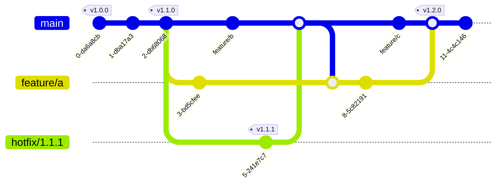
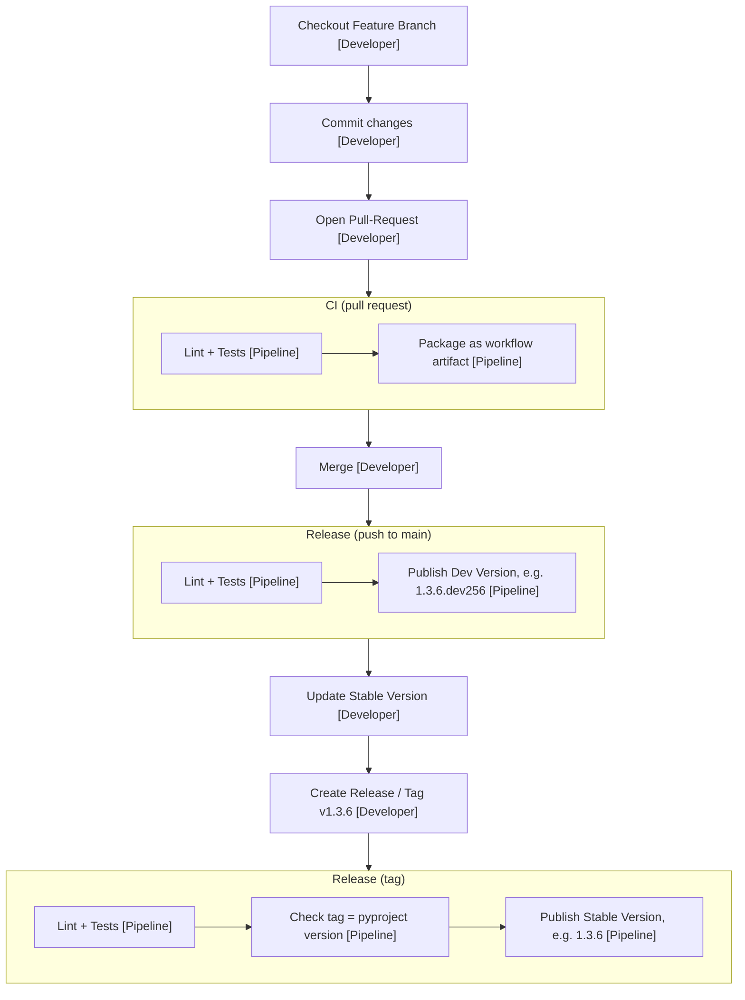

# Development and Release

## Naming Conventions

Work on a branch should always be related to an issue. The branch should be linked to the issue to have full transparency and traceability. The branch name can be the auto-generated one from GitHub (when creating a branch for an issue) or a custom one - preferably including the issue ID.

In order to trigger CI/CD flows properly and for transparency, **hotfix**-branches should always have the `hotfix/` prefix so we can have a custom automation for this case.

Commits messages should briefly describe the changes they're introducing but don't have a strict naming format or convention.

## Versioning

For versioning, mostly [semantic versioning](https://semver.org/) is used. Unfortunately, Python doesn't understand all details of semver, but it's
still the most viable solution and the basics can be used.

For stable/official versions, the common semver pattern is used:

- **Major** releases (5.0.0) indicate changes that will be incompatible with previous versions.
- **Minor** releases (5.1.0) add functionality while still being backward-compatible (in this example 5.1.0 would be compatible with 5.0.0).
- **Patch** (often termed Micro in Python) releases are minor bug fixes or security patches that should always be backward compatible (5.1.4).

For development versions, there are multiple options - since this package doesn't have a complex testing and verification process for release,
a simple format is used:

`<Major>.<Minor>.<Patch>.dev<GitHub Actions run number>`

Development builds are published for every push to `main`. If the version in `pyproject.toml` has already been released
(a tag `v<version>` exists), the dev build is based on the next patch version, e.g. `0.14.2.dev12` after release `0.14.1`.
This keeps dev builds ordered above the latest release (PEP 440: `0.14.1.devN < 0.14.1 < 0.14.2.devN`).

Pip won't treat those versions as stable, they can only be installed by specifying the exact version or using the `--pre` flag.

Pull requests are **not** published to PyPI. The CI attaches the built package (`dist-pr<number>`) as a workflow artifact
to the PR run instead.

## Git Flow



## Testing

Tests use **pytest**. Install dev and test dependencies first:

```bash
poetry install --with dev,test
```

### Unit and e2e suites

The suite is split into offline **unit tests** and developer-run **e2e tests** against a live VideoIPath instance:

| | Unit | E2E |
|---|---|---|
| Location | `tests/` (except `tests/e2e/`) | `tests/e2e/` |
| Marker | _(none)_ | `@pytest.mark.e2e` |
| Environment | Dummy `VIPAT_*` values in `tests/conftest.py` | Project root `.env` (see `.env.template`) |
| CI / default run | yes | no |

**Commands** (prefer these over bare `pytest`):

```bash
poetry run test-unit    # offline suite; same as CI
poetry run test-e2e     # live-server suite
poetry run test     # unit, then e2e (stops on first failure)

# Single file or test — extra args pass through
poetry run test-unit tests/validators/test_device_id.py
poetry run test-e2e tests/e2e/inspect/test_e2e_inspect.py::test_name
```

`poetry run pytest` also runs unit tests only (e2e is excluded via `addopts` in `pyproject.toml`). All default runs report coverage on `src/`.

### E2E setup

1. Copy `.env.template` to `.env` (gitignored) and set your server connection variables (`VIPAT_VIDEOIPATH_SERVER_ADDRESS`, credentials, etc.).
2. Run `poetry run test-e2e` or `poetry run test` — connection vars are loaded from `.env` automatically; no extra env vars on the command line.

E2E writes are namespaced (`E2E-` label prefix, `vipat-e2e` tag) so a shared dev instance stays safe.

### VS Code

Launch configs in `.vscode/launch.json`:

- **Unit Tests** / **Unit Tests (current file)** — offline suite
- **E2E Tests** / **E2E Tests (current file)** — live-server suite (loads `.env`, uses the project `.venv`)

Or run **Tests** from `.vscode/tasks.json` (`poetry run test`).

### Test data

Committed fixtures and examples must be anonymized — see `AGENTS.md` for placeholder conventions.

## Publishing / Releasing new Package Versions

In order to publish a new version of the package, update the version in the `pyproject.toml` and create a new GitHub Release associated with a version tag `v<version>`. The tag must match the version in `pyproject.toml`, otherwise the release workflow fails before building. The release notes should contain all relevant changes, especially breaking changes, features & bug fixes.

### Workflows

| Workflow | Trigger | Purpose |
|---|---|---|
| `ci.yml` | Pull requests to `main`; called by `release.yml` | Ruff lint + format check, unit tests (Python 3.11–3.14), PR package artifact. Read-only token, no secrets. |
| `release.yml` | Push to `main`, tags `v*` | Runs `ci.yml`, builds the package (tag/version check or dev version), publishes to PyPI via Trusted Publishing. |

Publishing uses [PyPI Trusted Publishing](https://docs.pypi.org/trusted-publishers/) (OIDC) from the GitHub environment `pypi`; no PyPI API token is stored in the repository.

### Linting

Ruff runs from the Poetry environment (`poetry.lock`) in CI, pre-commit and locally, so all three use the same version:

```bash
poetry run ruff check
poetry run ruff format --check
```


